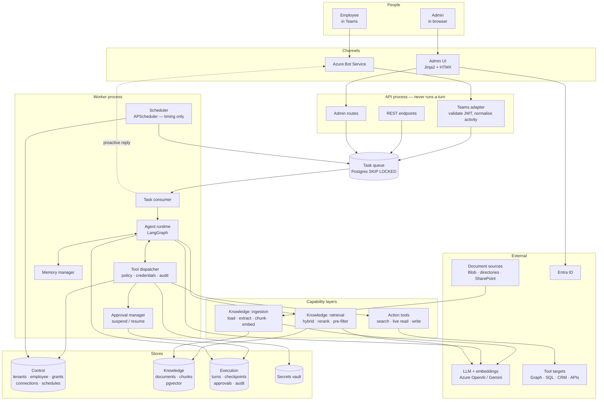
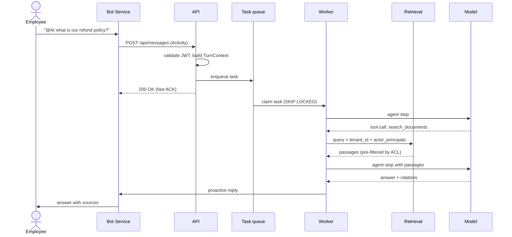
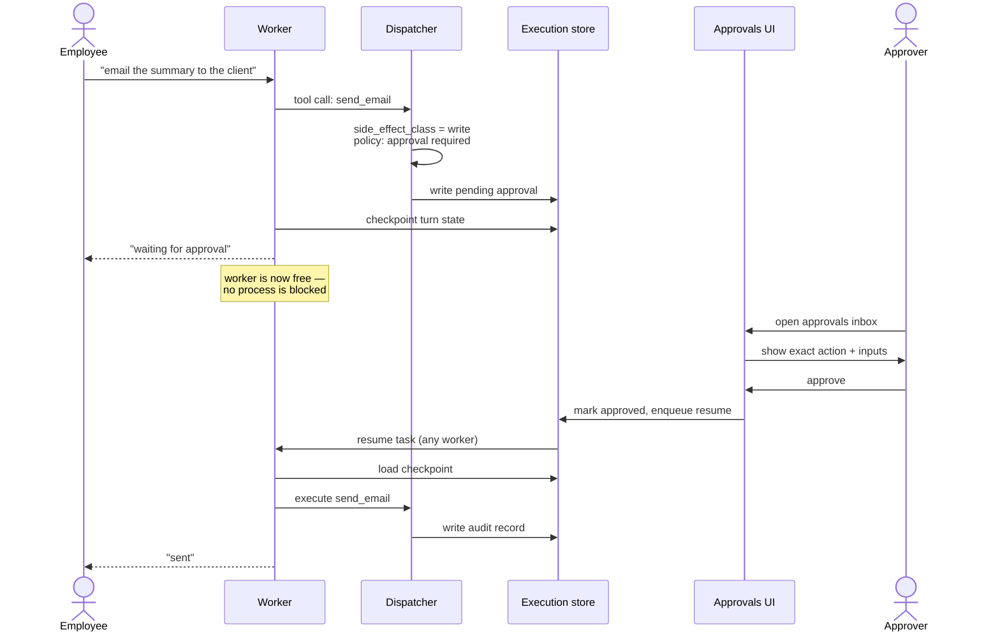
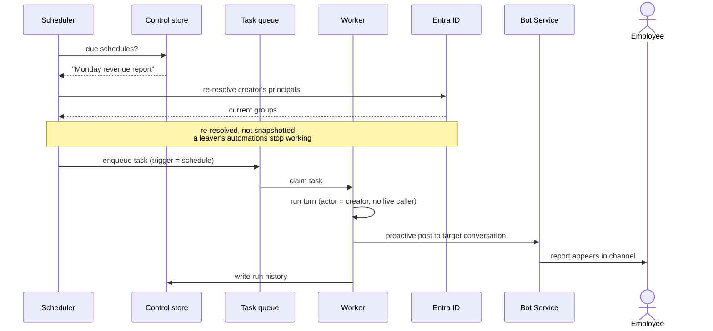
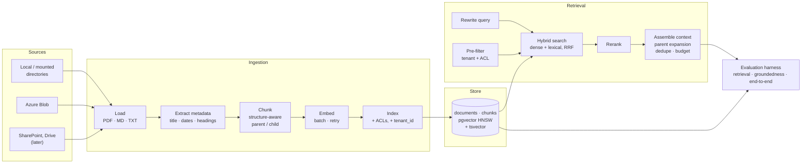

# Prototype Architecture

Companion to [SCOPE.md](SCOPE.md). Mermaid diagrams render on GitHub.

## Overview

The one structural fact to read off this: **the API never runs an agent turn.** It accepts,
normalises, enqueues, and acknowledges. Everything that thinks happens in the worker. That
is what makes approvals, scheduling, and long autonomous work possible at all.

```
          Employee (Teams)                 Admin (browser)
                 │ @mention                       │ HTTPS
                 ▼                                ▼
      ┌──────────────────────┐        ┌──────────────────────┐
      │  Azure Bot Service   │        │   Admin UI (HTMX)    │
      └──────────┬───────────┘        └──────────┬───────────┘
                 │                               │
    ═════════════▼═══════════════════════════════▼═════════════
                         API  process
      Teams adapter  ·  REST API  ·  Admin routes
      validate → build TurnContext → enqueue → ACK fast
    ═════════════════════════┬═════════════════════════════════
                             ▼
                   ┌───────────────────┐
                   │  Task queue       │   Postgres,
                   │  (SKIP LOCKED)    │   SKIP LOCKED
                   └─────────┬─────────┘
                             ▼
    ═════════════════════════════════════════════════════════════
                        WORKER  process
      ┌──────────────────────────────────────────────────────┐
      │ Agent runtime (LangGraph)   ◄──► Tool dispatcher     │
      │   agent node ↔ tool node          policy · creds     │
      │                                   · audit            │
      │ Memory manager   Approval manager   Scheduler        │
      └───────┬───────────────────┬──────────────────┬───────┘
              │                   │                  │ fires
              ▼                   ▼                  ▼
      Knowledge layer       Action tools        writes task
      hybrid retrieval      search · read       (timing only)
      rerank · filter       · write
    ═════════════════════════════════════════════════════════════
              │                   │
              ▼                   ▼
      ┌───────────────┐   ┌──────────────────────────────┐
      │  Postgres     │   │  External systems            │
      │  control      │   │  Blob · Graph · SQL · CRM    │
      │  knowledge    │   │  LLM · embeddings · Entra    │
      │  execution    │   └──────────────────────────────┘
      │  + vault      │
      └───────────────┘

              Worker replies proactively ──► Teams
```

## Components



## Flow 1 — an interactive turn

Note where the acknowledgement happens. Teams requires a fast response; the real answer
arrives later on a separate outbound call.



## Flow 2 — approval, suspend and resume

This is the seam that is hardest to retrofit. The turn stops, is persisted, and continues
in a **different process** — possibly hours later.



## Flow 3 — a scheduled run, nobody present

The scheduler only decides *when*. It writes a task and the worker runs it down the same
path an interactive turn takes, so the two cannot drift apart.



## Flow 4 — the knowledge layer



Pre-filtering is drawn as an input to the search, not a step after it. Filtering HNSW
results afterwards destroys recall — you search the whole index, get ten neighbours, and
discard nine as other tenants'.

## What crosses which boundary

| Boundary | Carries | Must not carry |
|---|---|---|
| Channel adapter → API | Normalised `TurnContext` | Teams-specific activity shapes |
| API → queue | Task + `TurnContext` | Anything requiring the HTTP request to stay open |
| Dispatcher → tool | Resolved credential, validated inputs | — |
| Tool → model | Results only | **Credentials, ever** |
| Retrieval → model | Passages the actor is entitled to | Any chunk outside the actor's ACL |
| Actor memory → channel reply | — | Private per-user memory in a shared channel |

`TurnContext` is the contract that makes the four entry points interchangeable. If Teams
concepts leak past the adapter, adding Slack later stops being cheap.

Every store access is tenant-scoped, with Postgres RLS as the enforcement rather than
developer discipline — one forgotten `WHERE` is otherwise a cross-tenant leak.