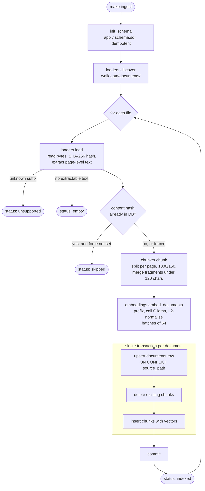
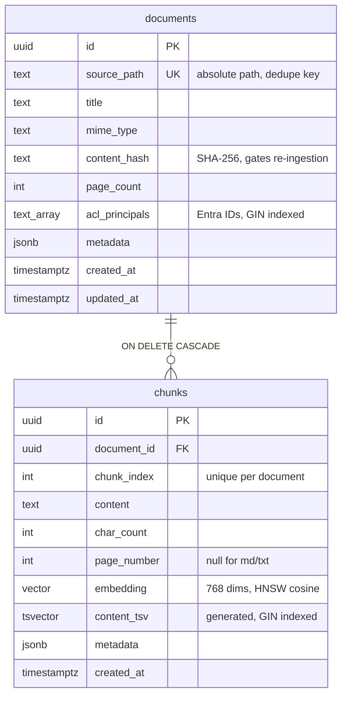
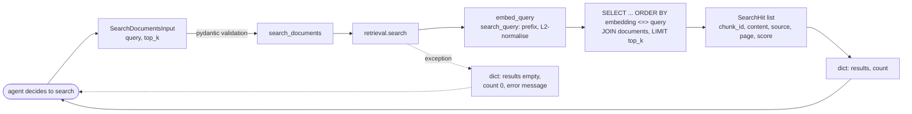
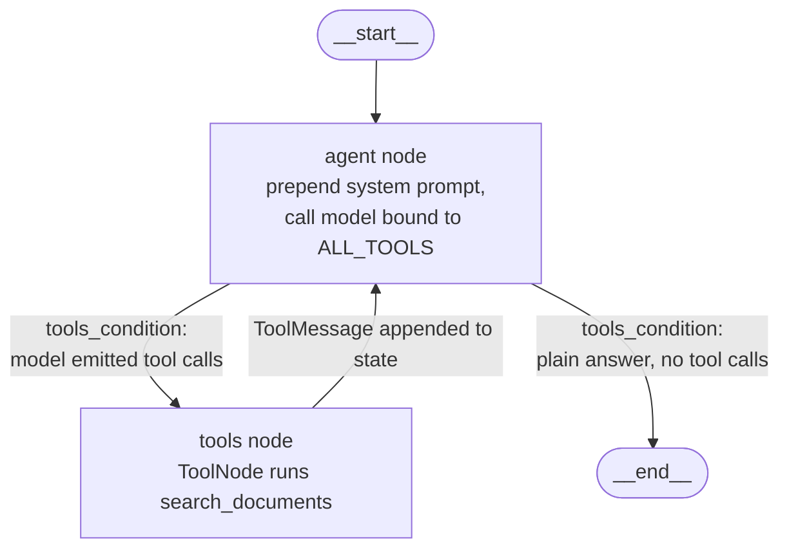
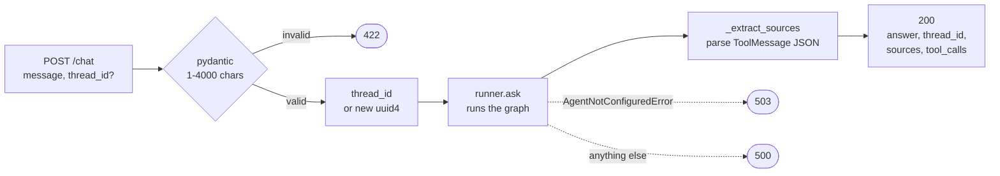
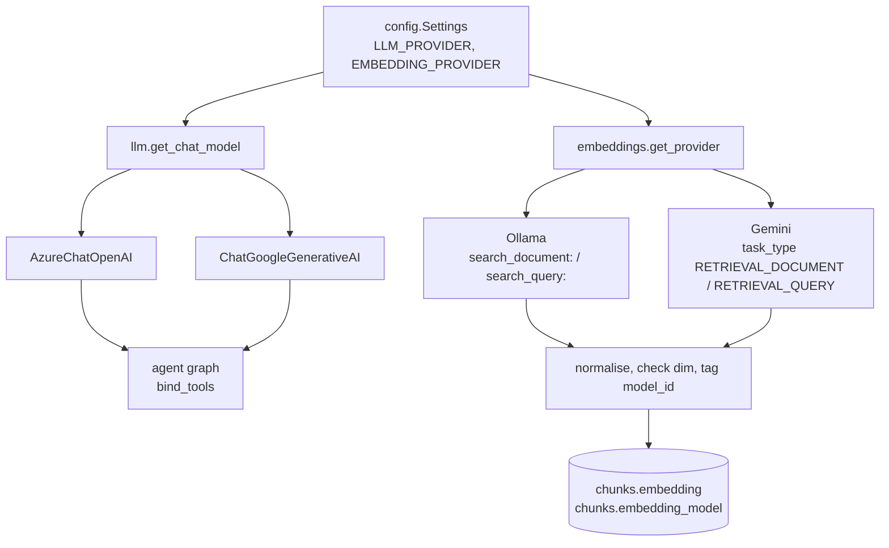
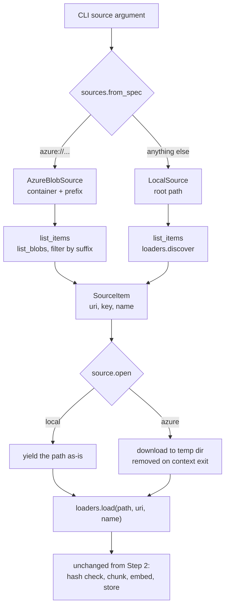
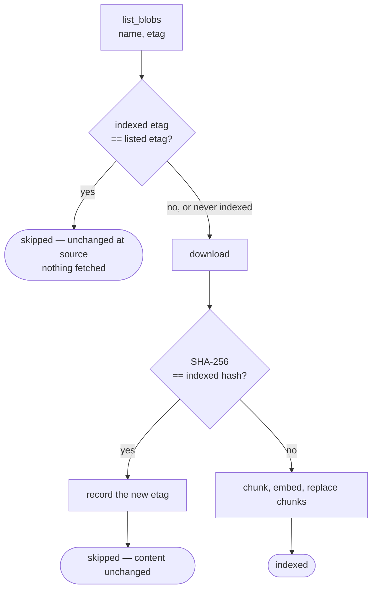

# Implementation Notes

Companion to [`AI_Employee_Documentation.md`](AI_Employee_Documentation.md). The master
document describes *what the platform is meant to be*; this one records *what has actually
been built, and why each choice was made*, step by step as the build progresses.

Read this when you come back to the code after a gap and need to remember why something
looks the way it does.

| Step | Scope | Status |
|---|---|---|
| 1 | Docker Compose foundation, uv project, source layout | Built, not yet started |
| 2 | Ingestion pipeline: load → chunk → embed → store | Built, partially verified |
| 3 | `search_documents` tool | Built, partially verified |
| 4 | LangGraph agent | Built, partially verified |
| 5 | FastAPI `/chat` endpoint | Built, partially verified |
| 6 | End-to-end smoke test | Not started |

---

## Step 1 — Foundation

Two containers and a Python project. Nothing application-specific yet.

**`docker-compose.yml`** runs `pgvector/pgvector:pg16` (Postgres with the vector extension
already compiled in) and `ollama/ollama`. Credentials come from `.env` via variable
substitution, so no secret is ever written into the YAML. Host ports are overridable
(`POSTGRES_PORT`, `OLLAMA_PORT`) because a second Postgres on 5432 is a common local
collision. Both services declare healthchecks and named volumes, so data survives
`docker compose down`.

**`init.sql`** runs `CREATE EXTENSION IF NOT EXISTS vector`. Note the timing: files in
`/docker-entrypoint-initdb.d/` execute *only* on first initialisation of an empty data
volume. Once `pgdata` exists, editing this file has no effect — which is precisely why the
application schema lives elsewhere (see `schema.sql` below) rather than being bolted on
here.

**`pyproject.toml`** is a uv project using a hatchling build backend with a `src/` layout.
`[tool.uv] package = true` makes `uv sync` install the project itself in editable mode, so
`ai_employee.*` imports resolve from anywhere without `PYTHONPATH` juggling.

**`Makefile`** exists mainly to pin `UV_PROJECT_ENVIRONMENT` to `~/.virtualenvs/general`.
The repository sits on a `/mnt/c` Windows mount, where package I/O under WSL is slow enough
to be worth avoiding; keeping the virtualenv on ext4 is a real speed difference, not a
preference.

**Source layout** — one importable package root, `src/ai_employee/`, with `agent/`,
`tools/`, `ingestion/`, and `api/` beneath it. A flat `src/agent/`, `src/tools/` tree would
put top-level names like `agent` and `api` on the import path, where they collide with
installed distributions.

**`config.py`** is a `pydantic-settings` model read from `.env`, exposed through a cached
`get_settings()`. Every module reads configuration from there; nothing calls `os.environ`
directly.

---

## Step 2 — Ingestion pipeline

The job: turn a file on disk into rows in Postgres that can be searched by meaning rather
than by keyword. Everything downstream — the retrieval tool, the agent's citations, the
eventual access-control filtering — is shaped by decisions made here.

### Flow



### Data model

Two tables. `documents` is one row per file; `chunks` is one row per retrievable passage.



Why the schema is hand-written rather than delegated to `langchain-postgres`: that library
stores everything in a `langchain_pg_embedding` table with an opaque JSONB metadata blob.
The retrieval tool has to return `source`, `score`, and `chunk_id` as structured fields to
enforce the citation rule, and access filtering later needs to be a real indexed `WHERE`
clause. Both want actual columns.

Two columns are deliberately dead weight today:

- **`content_tsv`** — a generated `tsvector` with a GIN index. It is the lexical half of the
  hybrid search planned for a later phase. Because it is `GENERATED ALWAYS AS ... STORED`,
  it populates itself for every row written from now on, so switching on hybrid search costs
  a query change rather than a backfill.
- **`acl_principals`** — a `TEXT[]` with a GIN index, empty meaning unrestricted. Adding
  access control later becomes `WHERE acl_principals = '{}' OR acl_principals && %s`, with
  no migration and no re-embedding.

The vector index is **HNSW with `vector_cosine_ops`**. Compared with IVFFlat it gives better
recall at the same latency and, importantly, needs no training pass over existing rows —
IVFFlat built on an empty table produces a useless index and would have to be rebuilt after
the first real ingestion.

`schema.sql` is applied by `db.init_schema()` on every ingestion run, not by `init.sql`, for
the timing reason described in Step 1. Every statement is `IF NOT EXISTS`, so repeated runs
are harmless. This is a deliberate stand-in for a real migration tool — once the schema
starts changing in incompatible ways, it should become Alembic.

### Modules

**`loaders.py`** — file bytes to page-level text.

Supports `.pdf` (via pypdf), `.md`, and `.txt`; anything else raises
`UnsupportedFileTypeError`, which the pipeline catches and reports rather than crashing the
whole run. Output is a `LoadedDocument` holding a list of `Page` objects, each with an
optional 1-based page number — populated for PDFs, `None` for the text formats.

The page-level granularity exists so citations can name a page. Concatenating a PDF into one
string first would be simpler and would throw that away permanently.

The SHA-256 hash is computed over raw bytes in 64 KB blocks, so a large PDF is never held in
memory twice.

**`chunker.py`** — text to retrievable passages.

`RecursiveCharacterTextSplitter` at 1000 characters with 150 of overlap, trying separators
in order: paragraph, line, sentence, word. The overlap exists because a passage split
mid-argument loses the context that makes it answerable; 15% is the usual starting point.
Splitting happens **per page**, so a chunk never straddles a page boundary and its page
citation stays truthful.

One non-obvious piece: `_merge_undersized`. Splitting on `\n\n` strands markdown headings as
their own passages — a real observed output was an 11-character chunk containing only
`## Security`. Embedding that produces a vector with no answer in it that can still rank
well against a query about security. Anything under 120 characters is therefore folded
*forward* into the following passage, which is the right direction: a heading belongs with
the section it introduces. On the test document this collapsed 6 chunks into 4 and removed
both fragments. A merged chunk can slightly exceed `CHUNK_SIZE` — accepted, since the
overshoot is heading-sized.

**`embeddings.py`** — text to vectors. Shared with the retrieval tool rather than living
inside `ingestion/`, because both sides must behave identically.

`nomic-embed-text` is trained with **task prefixes**, and they are asymmetric:
`search_document: ` when indexing, `search_query: ` when searching. Omitting them degrades
retrieval; swapping them is worse. They are module constants so the two call sites cannot
drift apart. Note that Ollama does not add these automatically.

Vectors are **L2-normalised** before storage. Cosine distance then reduces to a dot product,
which keeps the HNSW `vector_cosine_ops` index and the scores it returns consistent
regardless of whether Ollama normalised its output.

**`db.py`** — connection handling.

`connect()` yields a psycopg connection with the pgvector type adapters registered, so
Python lists can round-trip as `vector` values. It takes `register_types=False` for one
specific case: `init_schema()` runs before the extension is guaranteed to exist, and
registering the adapter first would fail on a fresh database. `dsn()` strips the
`+psycopg` driver suffix, since `DATABASE_URL` is written in SQLAlchemy form for the
benefit of later components while psycopg wants plain libpq.

**`pipeline.py`** — orchestration.

Per document: hash check, chunk, embed in batches of 64, then write. The write is one
transaction containing an upsert on `source_path`, a `DELETE` of the document's existing
chunks, and the inserts. Re-ingestion replaces the chunk set wholesale rather than
attempting an incremental update, because chunk boundaries shift when a document changes —
matching old chunks to new ones is guesswork, and the failure mode is orphaned passages that
still answer queries with stale content.

Every file produces an `IngestResult` with one of four statuses — `indexed`, `skipped`,
`empty`, `unsupported` — so one unreadable file in a directory never aborts the batch.

**`run.py`** — the CLI behind `make ingest`.

```
uv run python -m ai_employee.ingestion.run [source] [--force] [--acl PRINCIPAL] [--skip-schema]
```

Defaults to `data/documents/`; `source` also accepts an `azure://` URI, described under
[Document sources](#cross-cutting--document-sources). `--force` re-indexes despite an unchanged hash, which is what
you want after changing chunking parameters or the embedding model. `--acl` is repeatable
and tags the ingested documents with principals, ready for the access-control phase.
`--skip-schema` skips the DDL pass. Exit code is non-zero when the source is missing or
nothing matched.

### Verification status

Confirmed by running against a throwaway file: loading, hashing, recursive discovery, the
unsupported-extension path, chunking, the fragment merge, and its edge cases (all-tiny
input, empty input).

Not yet exercised, because both need the containers running:

- the Ollama embedding call, including the assumption that `nomic-embed-text` returns
  exactly 768 dimensions to match `vector(768)`;
- every database write, including whether psycopg accepts the multi-statement `schema.sql`
  in a single `execute()`.

---

## Step 3 — The `search_documents` tool

Step 2 filled the store; this step is the read path, and the first piece the agent will
actually call.

### Flow



### Two modules, not one

`retrieval.py` holds the SQL and the embedding call; `tools/search_documents.py` is a thin
LangChain wrapper over it. The split matters for the evaluation phase: retrieval quality
(is the right passage in the top 5?) is measurable directly against `retrieval.search`,
with no model, no tool-calling machinery, and no token spend. Folding the SQL into the
decorated function would make that impossible to test in isolation.

`tools/__init__.py` exports `ALL_TOOLS`, which is what gets passed to `bind_tools` in Step 4.
Adding `query_database` or `web_search` later means appending to that list and nothing else.

### Query and scoring

```sql
1 - (c.embedding <=> %(query)s) AS score
...
ORDER BY c.embedding <=> %(query)s
```

`<=>` is PGVector's cosine distance operator. The ordering uses the raw distance because
that is what the HNSW index is built on — wrapping it in arithmetic there would prevent the
index from being used and force a sequential scan over every chunk. The `SELECT` converts it
to a similarity so the score rises with relevance, which is easier both for the agent to
interpret and for you to read in logs. Because vectors are L2-normalised on write, this is a
true cosine similarity in roughly the 0–1 range.

The query embedding uses the `search_query:` prefix; the indexed passages used
`search_document:`. Same model, opposite prefix — this asymmetry is the whole reason
`embeddings.py` is shared rather than duplicated.

### Guards

**`top_k` is clamped twice.** Pydantic rejects anything outside 1–20 before the function
runs, and `retrieval.search` clamps again for direct callers. The model picks this value, and
an unbounded `LIMIT` chosen by an LLM is a denial-of-service on your own database.

**Failures return data, not exceptions.** If Postgres or Ollama is unreachable, the tool logs
the traceback and returns `{"results": [], "count": 0, "error": ...}`. A raised exception
would abort the whole graph run in Step 4; an error payload lets the agent tell the user that
search is down. The error string is written for the model to act on, not for a human to read.

**The description is a module constant, not a docstring.** The decorator forwards a docstring
verbatim, continuation indentation included, and that text is sent to the model on every
single request. It also states what the tool does *not* cover — databases, web, email — which
is what stops the agent from reaching for it when the right tool does not exist yet.

### Deliberately absent

**No score floor.** Filtering out results below some similarity threshold is the obvious next
guard, but the cut-off cannot be picked honestly without measurements from real documents.
Set too high it silently returns nothing; too low it changes nothing. This belongs in the
evaluation phase, against a golden dataset.

**No ACL filtering.** `documents.acl_principals` exists and is indexed, but the query does not
reference it — every chunk is currently visible to every caller. That is acceptable only
while there is no auth layer and no multi-tenant data. It must be closed before anything
resembling real enterprise content is ingested; the change is a `WHERE` clause, not a
migration.

### Verification status

Confirmed without containers: tool binding and name, the JSON schema the model receives
(including the 1–20 bounds), the cleaned description text, `ValidationError` on
`top_k=500`, and the failure path returning a well-formed error payload instead of raising.

Unverified until the stack is up: the SQL itself. Nothing has executed `<=>`, the join, or
the `Vector` parameter binding against a live database.

---

## Step 4 — LangGraph agent

The reasoning loop. The model decides whether to search, reads what comes back, and either
searches again or answers. This is what makes the system *agentic* RAG rather than a fixed
retrieve-then-generate pipeline: nothing in the code decides that a search happens.

### Graph



Four nodes including the implicit start and end, three edges plus the conditional pair.
`tools_condition` is the whole routing decision: it inspects the last message and sends the
run to `tools` if the model emitted tool calls, otherwise to `END`.

State is `MessagesState` — a message list with an append reducer. Each pass adds the model's
reply; each tool run adds a `ToolMessage`. A single search costs four messages: human, AI
with tool calls, tool result, AI answer.

### Files

**`prompts.py`** holds `SYSTEM_PROMPT`. It is organised around the failure modes rather than
around capabilities: when to search, how to restate the query, that every company-specific
claim needs a citation, that "I could not find this" is a correct answer, that conflicting
passages must be reported as conflicting rather than silently resolved, and that a search
error must be reported rather than papered over with general knowledge. The style section
exists to stop the model softening precise policy language — "within 90 days" must not
become "a few months".

**`graph.py`** builds the model, the nodes, and the graph.

**`runner.py`** wraps a turn in `ask(question, thread_id)` and doubles as a CLI:

```
uv run python -m ai_employee.agent.runner "question" [--thread ID] [--show-tools]
```

### Decisions

**The system prompt is prepended per turn, not stored in state.** `agent_node` builds
`[SystemMessage(...), *state["messages"]]` on every call. Storing it as the first message of
the conversation would freeze whichever version was current when the thread started —
editing the prompt would then only affect new conversations, which makes iterating on it
confusing.

**`temperature=0`.** Grounded answers should not vary between runs, and the evaluation
harness in a later phase depends on repeatability.

**`recursion_limit = 12`.** Each search costs two steps, so this allows roughly five tool
round trips before LangGraph raises. Without a limit, a model that keeps re-searching on
empty results loops until the API bill says otherwise.

**Missing configuration fails loudly and specifically.** `AgentNotConfiguredError` names
exactly which of `AZURE_OPENAI_API_KEY`, `AZURE_OPENAI_ENDPOINT`, and
`AZURE_OPENAI_DEPLOYMENT` are absent, rather than surfacing an authentication error from deep
inside the SDK.

**Both the model and the compiled graph are `lru_cache`d.** The graph in particular must be a
singleton, because the checkpointer lives inside it — rebuilding it per request would discard
every conversation.

**Tool results reach the model as JSON.** `ToolNode` serialises the returned dict, so the
`ToolMessage` content is a parseable object rather than a Python `repr`. That is what will
make audit logging — recording which passages grounded which answer — a matter of reading
back the message history.

### Known limitation

`InMemorySaver` keeps conversation state in process memory. It is lost on restart and not
shared between workers, so it works for a single-process API and nothing beyond that. It
needs to become a Postgres checkpointer before more than one worker is involved. The database
is already there; this is a swap at `builder.compile(checkpointer=...)`.

### Verification status

The graph was compiled and its structure inspected — nodes, and both conditional branches out
of `agent`. The loop was then driven end to end with a stub model substituted for Azure, with
no API key and no database running, which confirmed:

- the system prompt arrives as the first message and is absent from stored state;
- a tool call routes to `ToolNode`, which executes the real `search_documents`;
- the tool's error payload comes back as a `ToolMessage` and is fed to the next model call;
- the model's second reply, having no tool calls, terminates the run;
- the message sequence is human → AI → tool → AI;
- a second turn on the same `thread_id` resumes with the prior four messages, so the
  checkpointer is wired correctly.

Unverified: every real Azure OpenAI call. No request has been made, so the deployment name,
API version, and tool-calling behaviour of the actual model are all untested — as is whether
the prompt produces the citation discipline it asks for, which needs real documents and real
retrieval to judge.

---

## Step 5 — FastAPI `/chat`

The HTTP surface. Two endpoints, no auth yet.

| Method | Path | Purpose |
|---|---|---|
| `POST` | `/chat` | One conversational turn |
| `GET` | `/health` | Per-dependency readiness |



### Decisions

**The endpoint is `def`, not `async def`.** `ask()` blocks on three things — the Azure call,
Postgres, and Ollama — none of which are async in this codebase. Declaring it `async def`
would run that blocking work directly on the event loop and stall every other request in the
process. As a plain `def`, FastAPI dispatches it to a worker thread. This is a real
constraint, not a style choice; making the path genuinely async means an async database
driver and async embedding calls throughout.

**`thread_id` is the entire conversation contract.** Omit it and the server mints a `uuid4`
and returns it; pass it back to continue. There is no session, no cookie, and no server-side
notion of a user — the client owns the identifier. That is deliberate at this stage, and it
is also why there is no authorisation: anyone who knows a `thread_id` can continue that
conversation.

**`sources` is what the model was *shown*, not what it cited.** `_extract_sources` parses the
`ToolMessage` JSON and dedupes by `chunk_id`. The model may cite a subset, or — if the prompt
fails — none of them. The field is an audit trail answering "what grounded this turn?", which
is what the compliance section of the master document asks for. Reading it as a citation list
would overstate what it knows.

**Errors are separated by cause.** Missing Azure configuration returns `503` with the
specific variables named, because that is an operator problem and retrying will not fix it.
Anything else returns `500` with a generic message, while the traceback goes to the log —
internal errors should not be echoed to callers. Pydantic handles `422` for a message that is
empty or over 4000 characters.

**`/health` reports each dependency separately** and returns `503` when any is down. A single
boolean would say "unhealthy" without saying which of Postgres, Ollama, or the Azure config
is the problem. The Ollama check also verifies the embedding model is actually pulled, since a
running Ollama with no `nomic-embed-text` fails only later, at the first query.

### Known wart

`ai_employee.tools.search_documents` names both the module and the tool object re-exported
from `tools/__init__.py`. `from ai_employee.tools import search_documents` gives the tool;
`import ai_employee.tools.search_documents as X` gives the module. This is the ordinary
LangChain layout and both import styles work, but it will bite anything that monkeypatches
the module — as it did while testing this step, where `sys.modules[...]` was needed instead.

### Verification status

Exercised through `TestClient` with no containers and no Azure key:

- `/health` returned `503` naming all three failures independently — `OperationalError` for
  Postgres, `ConnectError` for Ollama, and the three missing Azure variables;
- `/chat` returned `503` with the specific missing settings;
- `422` for both an empty `message` and a missing one;
- with a stub model and stubbed retrieval, `/chat` returned `200` carrying the answer, a
  generated `thread_id`, two deduped sources with page and score, and the tool call with its
  arguments;
- passing a `thread_id` back returned the same one; omitting it produced a different one.

Unverified: everything that needs the real dependencies — an actual Azure response, real
retrieval, and the server running under uvicorn rather than `TestClient`.

---

## Cross-cutting — Provider abstraction

Added after Step 5, so the system can run on a free Gemini key instead of Azure plus a local
Ollama. This touched every layer, so it is recorded here rather than under a step.

The chat model and the embedding model are selected **independently**, by `LLM_PROVIDER`
(`azure_openai` | `gemini`) and `EMBEDDING_PROVIDER` (`ollama` | `gemini`). Local embeddings
with a hosted chat model is a sensible combination and the design does not get in its way.



### Where the vendors live

`llm.py` and `embeddings.py`. Nothing else in the codebase names a provider — `graph.py`
calls `get_chat_model()`, `pipeline.py` and `retrieval.py` call `embed_*`. Each module holds
a registry mapping a provider name to a builder plus its required settings, so adding a third
provider is a builder function and one dictionary entry.

Vendor SDKs are imported **inside** the builders rather than at module top level, so an
unused provider's package never has to be importable at runtime.

`AgentNotConfiguredError` is now an alias for the provider-neutral `LLMNotConfiguredError`,
keeping the agent package's public name stable.

### The part that is not just configuration

Embeddings from two different models are **not comparable**. Cosine similarity between a
nomic vector and a Gemini vector is a meaningless number that still sorts, which is the
dangerous kind of wrong — retrieval would return confident nonsense rather than failing.

Three things guard against it:

1. **Every chunk records `embedding_model`** — `ollama:nomic-embed-text`,
   `gemini:models/text-embedding-004` — as a column, indexed.
2. **Retrieval filters on it.** `WHERE c.embedding_model = %(embedding_model)s` means a
   switched provider sees zero results from chunks embedded by the previous model, rather
   than garbage rankings. The failure mode is empty, which is honest.
3. **The re-ingestion check knows about it.** Skipping on the content hash alone would be a
   trap here: after a provider switch the file is byte-identical, so every document would
   report `skipped` and stay permanently unsearchable with no error anywhere. `_is_unchanged`
   therefore requires both a matching hash *and* the existence of chunks embedded by the
   active model, so a plain `make ingest` re-embeds exactly what needs it.
4. **Dimensions are checked on every embedding call.** A model returning a width other than
   `EMBEDDING_DIM` raises `EmbeddingConfigError` naming both numbers, instead of failing
   later inside Postgres with a type error.

**The passage/query distinction is per-provider, not universal.** Ollama's `nomic-embed-text`
wants the literal prefixes `search_document: ` and `search_query: `; Gemini takes a
`task_type` of `RETRIEVAL_DOCUMENT` or `RETRIEVAL_QUERY` and would treat the nomic prefixes
as part of the text being embedded. Each provider class owns its own convention, which is the
main reason this is a class per provider rather than a single function with an if-statement.

**`EMBEDDING_DIM` is now substituted into the DDL**, since `vector(768)` is a column type and
cannot be a query parameter. It is a plain `str.replace`, not `str.format` — the schema
contains literal `'{}'` defaults for the array and JSONB columns, which `format()` would read
as placeholders and fail on. This only affects table *creation*; changing the width against an
existing `chunks` table needs a migration.

### Defaults

`azure_openai` + `ollama`, unchanged from before, so nothing about the existing setup shifted.
Gemini's defaults are `gemini-2.5-flash` and `models/text-embedding-004` — the latter is 768
dimensions natively, which matches the default `EMBEDDING_DIM` and the existing schema.
`GEMINI_EMBEDDING_OUTPUT_DIM` is unset by default and only needs setting for models that
support truncated output widths.

### Verification status

With no network calls: both providers selected in turn and their configuration checks
returning correctly for present and absent keys; `ollama:nomic-embed-text` and
`gemini:models/text-embedding-004` as model ids; the prefix and task-type conventions on the
right classes; `ChatGoogleGenerativeAI` constructed and accepting `bind_tools`;
`EmbeddingConfigError` raised for a 3072-wide vector against `EMBEDDING_DIM=768`; the DDL
rendering `vector(1536)` while leaving all three literal `'{}'` defaults intact; `/health`
reporting Gemini for both roles with only the database degraded; and the Step 5 API tests
still passing unchanged.

Unverified: any real Gemini API call. No request has been made to either the chat or the
embedding endpoint, so model names, quota behaviour, and the exact embedding width returned
are all untested.

---

## Cross-cutting — Document sources

Step 2 read from a directory. This adds Azure Blob Storage as a second origin without the
pipeline learning anything about either one.



### The seam

`sources.py` defines a two-method interface — `list_items()` and `open(item)`, the latter a
context manager yielding a local `Path`. Everything downstream still receives a readable file,
so the loaders, the chunker, and the SQL are untouched. A third source is a class, not a
change to the pipeline.

`open()` is a context manager specifically so the remote case can clean up after itself. The
blob is downloaded into a `TemporaryDirectory` that is removed when the block exits;
`ingest_item` loads inside that block and does everything else outside it, since parsing has
already pulled every page into memory by then. Nothing accumulates on disk across a container
with a thousand blobs.

### Identity is not the file path

`SourceItem` carries three fields because the path a document is *read from* stopped being the
path it *is*:

- **`uri`** — the stable, globally unique identity, stored as `documents.source_path`. For a
  blob that is `azure://<account>/<container>/<blob>`. The account is in there deliberately:
  two storage accounts can both hold a `policies` container, and without it they would collide
  on the unique index and silently overwrite each other.
- **`key`** — the provider-native locator used to fetch the bytes (an absolute path, or a blob
  name). Kept separate so `open()` never has to parse the URI back apart.
- **`name`** — the file name. `loaders.load` now takes `uri` and `name` as overrides, because
  the temporary download is called something like `/tmp/ai-employee-blob-xyz/leave.md`.
  Deriving the title from the temp path would work by accident today and break the moment the
  temp file is named anything else; deriving `source_path` from it would be actively wrong,
  producing a new document row on every run.

This is also why `IngestResult` reports `uri` and `name` rather than a `Path` — a `Path` for a
blob is a lie that formats convincingly.

### Auth

Two styles, resolved in `AzureBlobSource._client`:

1. **`AZURE_STORAGE_CONNECTION_STRING`** — checked first. Simplest for local testing, but it
   embeds the account key and therefore grants the entire account.
2. **`AZURE_STORAGE_ACCOUNT_URL`** with `DefaultAzureCredential` — no secret in `.env`.

The second is not restricted to workloads running on Azure, which is the usual
misunderstanding. `DefaultAzureCredential` is a chain: a managed identity when the host has
one, otherwise the `AZURE_TENANT_ID` / `AZURE_CLIENT_ID` / `AZURE_CLIENT_SECRET` service
principal read straight from the environment, otherwise the developer's `az login` session.
A client's on-premise server therefore uses the same code path with three environment
variables set.

The operational trap worth recording: the identity needs the **Storage Blob Data Reader**
role. Owner and Contributor are management-plane roles and do not grant data-plane reads, so
the portal looks correctly configured while `list_blobs` returns 403.

A SAS token was considered as a third style and left out. It only covers the case where a
client provides neither an app registration nor the account key, and it adds a third secret
and a third branch to carry until then.

The SDK imports live inside `_client`, matching the provider abstraction: nothing in a
filesystem-only run touches `azure.storage.blob`.

### Listing

`list_blobs(name_starts_with=prefix)` filters server-side rather than pulling the container and
discarding most of it. Two things are dropped locally: blob names whose suffix is not in
`SUPPORTED_SUFFIXES`, and the zero-length directory markers that hierarchical namespaces
expose as blobs ending in `/`. Failures — wrong container, expired credential, missing role —
become `SourceConfigError` with the container in the message, so the CLI prints one line and
exits 1 rather than surfacing an Azure stack trace.

### Incremental ingestion

The first cut downloaded every blob on every run, because the skip check needed a SHA-256 of
the bytes. On a container of any size that is the whole cost of the run, spent to conclude
that nothing changed.

Azure's answer is the **ETag**: an opaque token that changes on every write, returned by
`list_blobs` as part of the listing that is already being made. So the version is known
before the download decision, not after.



**The ETag never becomes the definition of "changed".** The content hash stays the authority;
the ETag is a hint that can only skip work, never authorise it. This is what makes the second
stage necessary: a copy, a re-upload, or a metadata edit moves the ETag without changing a
byte, and that must cost a download but not an embedding pass. Recording the new ETag at that
point is the part that stops it recurring — without it, a touched blob re-downloads forever.

Both stages carry the `embedded_by_current_model` condition from the provider work, for the
same reason it was needed there: after an embedding switch every document is byte-identical
and ETag-identical, and skipping on either would leave the whole corpus unsearchable in
silence.

**The stored ETag is the one from the download, not the listing.** A blob rewritten between
the two calls would otherwise be stored with the old token against the new bytes — and since
the token then "matches", it would be skipped permanently. Taking the ETag off the download
response makes the pair self-consistent whichever version won the race.

`documents.source_version` holds it, nullable, added by an `ALTER TABLE ... ADD COLUMN IF NOT
EXISTS` since `CREATE TABLE IF NOT EXISTS` does nothing to an existing table. A pre-existing
row has no version, falls through to the hash check, and backfills itself — so the upgrade
costs exactly one full pass and then goes quiet. The local source fills the same field with
`mtime_ns:size`, which is coarser (a touch moves it) but lands in the same two-stage check.

### Deletions

Nothing else in the run notices that a document has disappeared. `ingest` walks what the
source lists and upserts each item, so a deleted blob keeps its rows, keeps matching queries,
and keeps being cited by an agent that has no way to know. A rename is the same failure in
disguise: a new URI creates a new row and abandons the old one, so both versions now answer.

`--prune` reconciles the store against the listing: delete every document whose URI starts
with the source's prefix and was not in the listing, chunks following by `ON DELETE CASCADE`.

Two constraints on that DELETE, both load-bearing:

- **It is bounded by `source.uri_prefix`**, which each source defines to mirror its own
  listing scope exactly — `name_starts_with` for Azure, the root with a trailing separator
  for a local directory. Ingesting one prefix can therefore never delete another's documents.
- **An empty listing never reaches it.** `source_path <> ALL('{}')` is true of every row, so
  an empty listing would clear the entire prefix — which is precisely the shape of a mistyped
  prefix or a credential that lost its role. `ingest` returns before pruning when nothing was
  listed, and `_prune` refuses an empty list independently.

It is opt-in for the same reason: the cost of not pruning is a stale citation, while the cost
of pruning on a bad listing is the index.

### Verification status

Exercised against a stubbed container client — no Azure account, no network:

- spec parsing for `azure://container/prefix`, `azure://container`, and a bare `azure://`
  falling back to `AZURE_STORAGE_CONTAINER`, plus its error when that is unset;
- the prefix reaching `list_blobs` server-side, and local filtering dropping both the `.png`
  and the directory marker;
- `azure://<account>/<container>/<blob>` as the stored URI, with `key` and `name` split
  correctly for a nested blob;
- download to a temp file that keeps its suffix, the title coming from the blob name rather
  than the temp path, and the temp directory being gone after the context exits;
- an unsupported blob raising `UnsupportedFileTypeError` naming the blob, not the temp file;
- both CLI error paths exiting 1 with a single line.

The incremental behaviour was then driven against the **real database** with a stubbed
embedder, counting downloads and embedding calls per run:

- first run indexed both blobs, two downloads, and stored the ETag unquoted;
- an unchanged re-run performed **zero downloads and zero embedding calls**;
- an ETag change over identical bytes downloaded once, embedded nothing, recorded the new
  ETag, and the run after it downloaded nothing — the touch does not recur;
- an edited blob re-indexed and re-embedded, downloading only itself, and replaced its chunks
  rather than accumulating them;
- a deleted blob survived a plain run and was removed by `--prune`, leaving no orphaned
  chunks;
- a document under a sibling prefix survived that prune untouched;
- `_prune` with an empty listing deleted nothing;
- `--force` re-indexed despite a matching ETag.

Against the live database on the local path: the `ALTER TABLE` applied to the existing
`documents` table, the pre-existing row fell through to the hash check and backfilled its
version (`skipped — content unchanged`), and the run after it took the cheap path
(`skipped — unchanged at source`). `documents.source_path` kept the same absolute-path form
as before the refactor.

Unverified: every real Azure call. No request has been made to Blob Storage, so neither
credential style, the listing, the ETag format that account returns, nor the download has run
against an actual container.